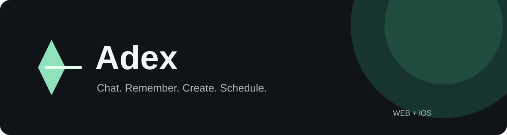
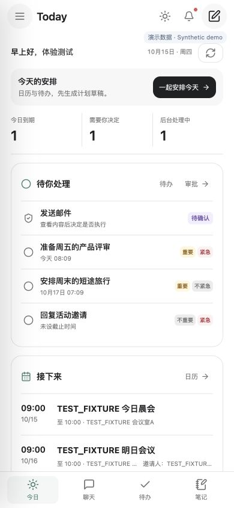
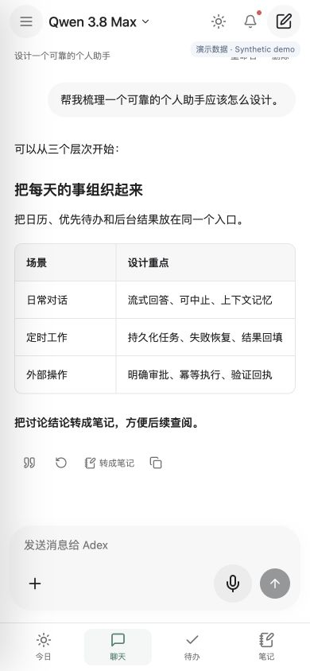
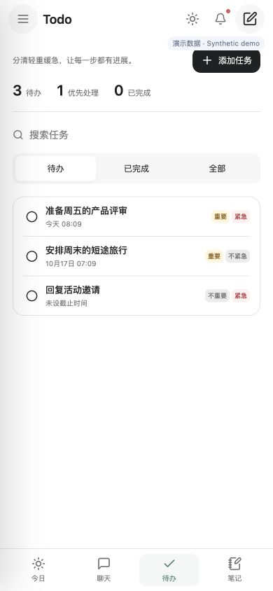
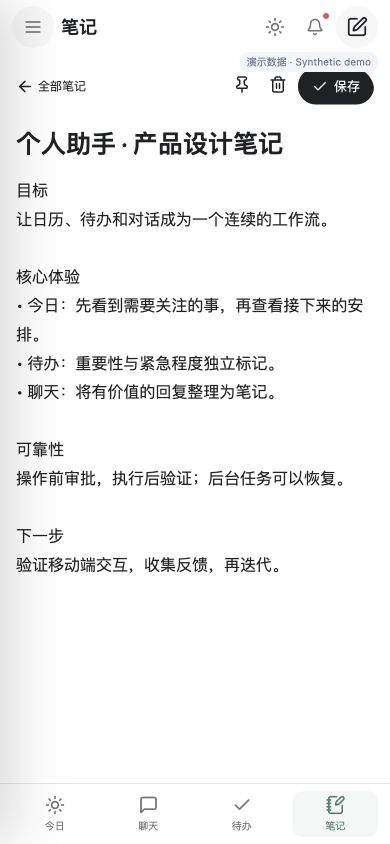
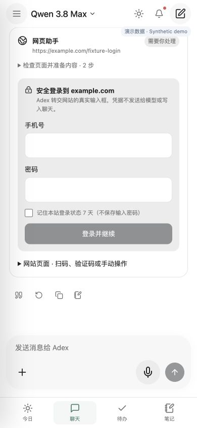
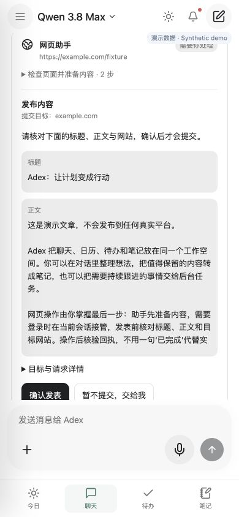
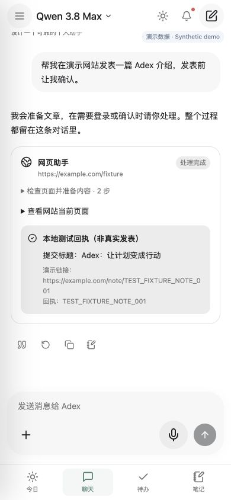
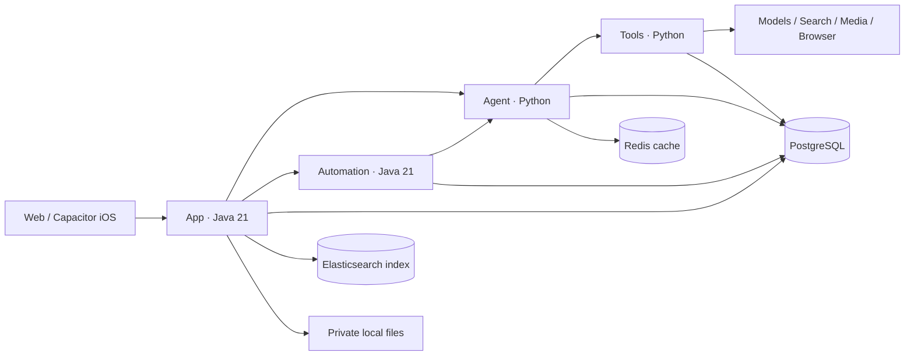

<div align="center">



**Your self-hosted personal AI assistant — remember context, organize your day, and follow through.**

[English](README.md) · [简体中文](README.zh-CN.md) · [Try the UI](#try-the-interface) · [Install](docs/en/installation.md) · [Contribute](CONTRIBUTING.md) · [Community](https://github.com/jiamingze/Adex/discussions)

[](https://github.com/jiamingze/Adex/actions/workflows/core.yml)
[](LICENSE)


</div>

Adex connects **chat, memory, daily planning, notes and background work** in one Web/iPhone workspace. Run it on your own infrastructure, bring your model keys, and keep each user's data separate. Built for people who want a personal assistant and developers who want to study how a recoverable agent works.

- **Remember what matters.** Model-assisted memory turns informal preferences into editable facts, recalls them in later chats, and respects correction, deletion and opt-out.
- **Keep working after you leave.** Scheduled briefs and background tasks persist, recover after interruption and return results to the original conversation.
- **Stay in control of actions.** Web tasks can ask for login inside the chat, show a frozen draft for approval, and report observed receipts. Real merchant flows still need external validation.

**Early developer preview.** There is no hosted public service or App Store download. UI demos use synthetic data. Real models, Google OAuth, APNs and media require your own configuration; availability varies by provider. See [what is verified and what is blocked](docs/IMPLEMENTATION_STATUS.md).

## A workspace for your day

| Today | Chat | Tasks | Notes |
| --- | --- | --- | --- |
| [](docs/images/gallery/today-mobile.jpg) | [](docs/images/gallery/chat-mobile.jpg) | [](docs/images/gallery/tasks-mobile.jpg) | [](docs/images/gallery/notes-mobile.jpg) |

Responsive Web at 390×844, with invented accounts and content; these are not native iPhone acceptance tests. [More screenshots and reproduction steps](docs/product/screenshot-gallery.md).

## Try the interface

**No model keys, database, Java or Xcode needed.** Install Node.js 22, pnpm 10.11.0, uv and Python 3.12+, then:

```bash
git clone https://github.com/jiamingze/Adex.git
cd Adex
make demo-ui
```

Open **http://127.0.0.1:18117/today?fault=calendar-plan**. Browse Today, Chat, Tasks and Notes. Stop with Ctrl+C. This loopback-only preview serves static synthetic responses: it does **not** run an LLM, save your notes or perform external actions. Never enter real credentials, expose it through a tunnel, or use it as a deployment.

## Run the real application

Choose the [installation guide](docs/en/installation.md) for macOS/Ubuntu or Docker Compose. Local development requires Java 21, Maven, Node.js 22, pnpm 10, Python 3.12+, uv, PostgreSQL 16 and Redis. FFmpeg supports media fixtures/composition. Use a normal user.

```bash
make doctor
make setup
uv run python scripts/init_env.py
# Edit the generated private .env: choose mock providers or supply your own keys.
make build
make up-dev
make status
```

Open **http://127.0.0.1:5173**. Guest chat is available; registered accounts unlock private attachments and durable tasks. Bootstrap credentials live in your `.env`; there is no shared default password. `make down-dev` stops application processes without deleting data.

iOS uses the same React UI in Capacitor. [Build/sign on your Mac](docs/en/installation.md#ios) with your own Apple team and a reachable HTTPS backend; free Personal Team signing needs periodic renewal. Dependency installation never requires iOS signing or a tunnel.

## Things to try

| Ask or do | Result / dependency |
| --- | --- |
| “I prefer quiet places and a relaxed pace.” | Semantic memory proposes concise preferences; inspect/correct/forget them in Memory. Requires a real model for semantic understanding. |
| “Every morning at 8, summarize the latest SpaceX news.” | Confirm a timezone-aware schedule; background results return to the chat. Live news requires Tavily. |
| Plan today | Today combines priorities, meetings and task results; iPhone calendar needs permission, Google needs OAuth configuration. |
| “每10min帮我巡检最新公告。” | Create an interval check with a durable receipt; suppress identical consecutive check notifications while retaining each result. |
| Important todo reminders | Important, unfinished todos notify ten minutes before the deadline through the existing durable scheduler and configured APNs channel; obsolete reminders are suppressed. |
| “What is tomorrow’s weather? Any hotels nearby?” | Opt into approximate foreground location or set a manual city. Recommendations need sourced evidence; no background tracking. [Location design](docs/architecture/location-context.md) |
| Save a useful reply | Turn it into a titled private note; read Markdown, switch to source editing/preview, search and pin it later. |
| Prepare a website post | Server-side browser, in-chat login/takeover, frozen-request approval and receipt reconciliation. Actual Xiaohongshu/Taobao compatibility is **BLOCKED_EXTERNAL** pending account acceptance. |
| Create a diagram, image, original music or video | Editable diagrams and private artifacts; real media generation requires a configured, entitled provider. Mock outputs are labelled. |

Qwen / MiniMax chat, automatic Tavily search, Markdown, attachments, stop/retry and conversation history are included. Google Calendar/Gmail connectors and APNs transport have fixture coverage; fixtures do not establish real account changes or notification delivery. Music catalog search links to authorized platforms; catalog access does not grant streaming rights.

<details>
<summary><strong>In-chat website workflow · synthetic examples</strong></summary>

  

Credentials are transient controls, outside model prompts and messages. Optional encrypted login sessions expire after seven days and can be revoked; input passwords are not saved. CAPTCHA/MFA or unsupported widgets may need takeover. Unknown results reconcile without blind resubmission. [Design and limits](docs/architecture/browser-operator.md).

</details>

## Built for recoverable execution



Exactly four business domains, with service-owned PostgreSQL schemas and owner-scoped APIs. Ordinary chat calls Agent directly; long work uses Automation's leases, fencing, immutable checkpoints and outbox. Tools records idempotent effects and reconciles uncertain submissions. L1 working / L2 conversation / L3 long-term memory have distinct lifecycles; deleted facts must not reappear from stale extraction or indexing.

Services can deploy independently and coordinate across instances. Included Compose is a **single-host starting point**, not automatic high availability. Phase 1 files live on App-owned persistent local disk; multi-host App replicas need explicit file routing or an approved shared-storage design. [Architecture](docs/en/architecture.md) · [Engineering boundaries](docs/architecture/engineering.md) · [Storage](docs/LOCAL_FILE_STORAGE.md).

## Find your way around

| Path | Responsibility |
| --- | --- |
| `apps/web`, `apps/ios` | React/TypeScript UI, Capacitor and native bridges |
| `services/adex-app` | Authentication, conversations, memory, files and public API |
| `services/adex-agent` | Routing, context, model calls and checkpoints |
| `services/adex-automation` | Schedules, durable Runs, claims and result delivery |
| `services/adex-tools` | Providers, connectors, approvals, effects and isolated runners |
| `packages`, `migrations`, `deploy` | Shared contracts/kernels, owned schemas and deployment |

[Installation](docs/en/installation.md) · [Configuration](docs/en/configuration.md) · [Development & code tour](docs/en/development.md) · [IDE setup](docs/en/jetbrains.md) · [Operations](docs/RUNBOOK.md) · [Memory](docs/architecture/conversational-memory.md) · [Connectors/APNs](docs/architecture/proactive-assistant.md) · [Skills](docs/architecture/skills.md) · [Roadmap](ROADMAP.md) · [Changelog](CHANGELOG.md)

## Contribute

[Join the community](https://github.com/jiamingze/Adex/discussions/1), [ask a question](https://github.com/jiamingze/Adex/discussions/categories/q-a), or [pick a good first issue](https://github.com/jiamingze/Adex/issues?q=is%3Aissue%20is%3Aopen%20label%3A%22good%20first%20issue%22).

Small, focused contributions are welcome: documentation, accessibility, reproducible mobile bugs and provider fixtures. [Choose a starter task](docs/project/starter-tasks.md), read [CONTRIBUTING.md](CONTRIBUTING.md), or [open an issue](https://github.com/jiamingze/Adex/issues/new/choose). English and Chinese are welcome; no paid model account or iPhone is needed for every contribution.

```bash
make test
make check-style
make test-integration
uv run python scripts/check_secrets.py
```

If Adex is useful to you, a star helps others find it. Share what you build in [Show and tell](https://github.com/jiamingze/Adex/discussions/categories/show-and-tell); reproducible bug reports and focused PRs are just as welcome.

Integration tests use isolated databases and explicitly labelled external fixtures, not personal keys. Keep real provider tests opt-in and cost-bounded. Read the [community guidelines](CODE_OF_CONDUCT.md) and report vulnerabilities via [SECURITY.md](SECURITY.md).

[MIT](LICENSE). Independent project, not affiliated with OpenAI, Alibaba Cloud or MiniMax. Provider names identify integrations; dependencies and content retain their own rights.
