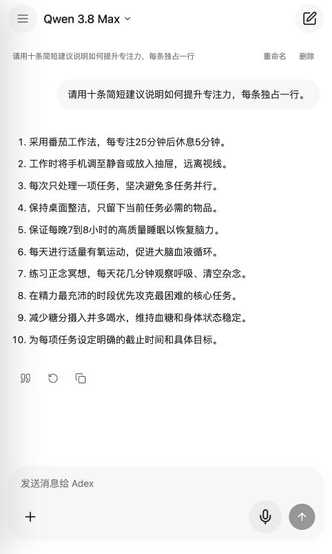
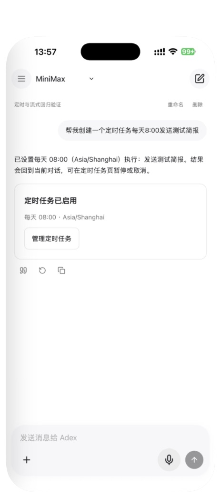
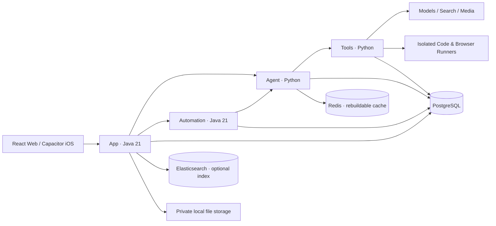

<div align="center">


**A self-hosted, multi-user AI workspace with persistent memory and durable agent execution.**

[English](README.md) · [简体中文](README.zh-CN.md) · [Installation](docs/en/installation.md) · [Architecture](docs/en/architecture.md) · [Contributing](CONTRIBUTING.md)

[](https://github.com/jiamingze/Adex/actions/workflows/core.yml)


[](LICENSE)


</div>

Adex is an open-source, self-hosted AI application for multiple users, with Web and iOS clients. It brings streaming chat, short- and long-term memory, autonomous web retrieval, scheduled work, and creative artifacts into one private workspace. Its four-service backend separates user data, agent execution, automation, and tools, so services can be deployed independently and background work can recover after interruption.

## What makes Adex different

| Core capability | What the implementation provides |
| --- | --- |
| **Multi-user by design** | Guest access, registration and login; owner-scoped conversations, memories, schedules, files and artifacts. Internal service calls validate scoped credentials and resource ownership. |
| **Short- and long-term memory** | L1 working context in Redis, L2 persisted conversation history and summaries, and L3 user-managed long-term facts with source provenance. Users can inspect, correct and delete memory; tombstones and revision checks prevent stale extraction from restoring deleted facts. |
| **Distributed service architecture** | Four independently deployable Java/Python services with service-owned PostgreSQL schemas. Schedulers and workers coordinate through database claims, leases and fencing; concurrent scheduler instances are covered by integration tests. |
| **Recoverable agent execution** | Immutable checkpoints, attempt IDs and authoritative checkpoint references support task recovery. Memory, checkpoints and run state have separate responsibilities and lifecycles. |
| **Durable automation** | Chat-created schedules and background tasks persist beyond the client session. Unique occurrences, Outbox delivery and deduplication return results to the original conversation. |
| **Provider-independent tools** | Qwen / MiniMax chat, Tavily search, server-side browser reads, and configurable image/music/video adapters. Tool-effect ledgers reconcile uncertain provider submissions instead of blindly repeating them. |
| **Private, versioned workspace** | App-authorized files and immutable artifact versions, private media playback, editable diagram sources and isolated generated-code execution. |
| **An engineering reference** | Capability modules, application services, persistence/provider ports, architecture checks, formatting gates, and integration/failure tests—not just a chat UI. |

**Deployment scope:** distributed service boundaries and multi-instance coordination are implemented; the included Compose setup is a single-host starting point. Phase 1 stores files on an App-owned persistent local disk. Multi-host App deployment needs explicit file routing or an approved storage design; a collection of separate local disks does not provide shared storage or automatic high availability. See [architecture](docs/en/architecture.md) and the [storage contract](docs/LOCAL_FILE_STORAGE.md).

**Status:** actively developed, early-stage software. This repository contains implemented services and tests, not a claim of production readiness. Real model capabilities require your own provider credentials. See [implementation status](docs/IMPLEMENTATION_STATUS.md) and [acceptance evidence](docs/ACCEPTANCE_EVIDENCE.md) for the limits of verification.

## What you can do

| Capability | Experience |
| --- | --- |
| Chat | Stream responses, switch Qwen / MiniMax, browse and delete history, render Markdown, retry and stop replies |
| Search | Automatically retrieve current information through Tavily and show sources |
| Memory | Working, conversation, and long-term memory; inspect, correct, and delete saved facts |
| Automation | Create daily schedules from chat; manage schedules, background tasks, and results returned to the original conversation |
| Create | Research reports, travel plans, sandboxed HTML games, editable diagrams, and provider-backed media |
| Music & video | Generate original audio/video with configured providers; save private artifacts and play/download results |
| Attachments | Upload images and documents, ask questions about supported files; native photo and voice adapters on iOS |
| Workspace | Private file storage, artifact versions, previews, and exports |

Image generation availability depends on the selected adapter. Deterministic mock media is explicitly labeled and does not count as real generation. Music catalog search links to authorized platforms; search results do not grant streaming rights. iOS photo upload, microphone recognition, and keyboard behavior require device-level validation; the latest device test boundaries are recorded in the status document.

## See it in action



<details>
<summary>iOS interface</summary>



Screenshots show development examples, not a public hosted demo. The pictured test schedule was cancelled after verification.
</details>

## Quick start: local development

Prerequisites: Git, Java 21, Maven, Node.js 22, pnpm 10, Python 3.12+, uv, PostgreSQL 16, and Redis. The local bootstrap supports macOS/Homebrew and Ubuntu PostgreSQL 16 layouts. Use a normal user, not root.

```bash
git clone https://github.com/jiamingze/Adex.git
cd Adex
make doctor
make setup
uv run python scripts/init_env.py
```

The initializer generates private credentials in `.env` and preserves an existing file. For a credential-free learning environment, set `ADEX_MODEL_PROVIDER=mock` and `ADEX_MUSIC_PROVIDER=mock` in `.env`. Mock answers are labeled. For real chat, configure MiniMax or Qwen; configure Tavily separately for search. See the [configuration guide](docs/en/configuration.md).

```bash
make build
make up-dev
make status
```

Open **http://127.0.0.1:5173**. Guest chat is available; register or log in for attachments, automation, and creative tasks. The bootstrap owner credentials are in your private `.env` — there is no shared default password.

```bash
make down-dev
```

For dependencies, Docker Compose, iOS signing, and troubleshooting, follow the [complete installation guide](docs/en/installation.md). For operation beyond localhost, use an authenticated HTTPS gateway; keep databases and internal services private.

## Architecture at a glance



Four business services keep distinct responsibilities. PostgreSQL is authoritative. Redis and Elasticsearch can be rebuilt; they do not own durable tasks or memory. Files are stored locally through App-owned metadata and permissions. Ordinary chat stays interactive; long-running work uses Automation. Read the [architecture guide](docs/en/architecture.md) for data ownership and failure recovery.

## Learn the codebase

```text
apps/web                 React + TypeScript client
apps/ios                 Capacitor container and Swift bridges
services/adex-app        Authentication, chat, files, memory, public API
services/adex-automation Schedules, durable runs, leases and delivery
services/adex-agent      Routing, context, providers and checkpoints
services/adex-tools      Search, media, research, travel and tool effects
packages                 Shared UI, contracts and service kernels
migrations               Service-owned PostgreSQL schemas
runners                  Isolated execution adapters
deploy                   Compose, Dockerfiles and gateway configuration
scripts                  Bootstrap, verification, backup and recovery
docs                     Guides, design decisions and acceptance evidence
```

Start with [development](docs/en/development.md), then trace `apps/web/src/api.ts` → `conversation/ConversationService` / `PostgresConversationStore` / `ChatWorker` → `adex_agent/api/chat.py` → `execution/interactive.py`. Explore the scheduler and effect ledger after understanding an interactive turn.

## Verification

```bash
make test
make check-style
make test-contract
make test-integration
uv run python scripts/check_secrets.py
```

Integration tests create isolated `adex_test_*` databases and mock external providers. They do not use personal API keys for paid calls. Some checks require Docker and system infrastructure; see [development](docs/en/development.md).

## Documentation

- [Skills and travel-to-booking roadmap](docs/architecture/skills.md)
- [Installation & iOS](docs/en/installation.md) / [安装与 iOS](docs/zh-CN/installation.md)
- [Architecture](docs/en/architecture.md) / [技术架构](docs/zh-CN/architecture.md)
- [Configuration](docs/en/configuration.md) / [配置说明](docs/zh-CN/configuration.md)
- [Development & learning path](docs/en/development.md) / [开发与学习路线](docs/zh-CN/development.md)
- [Operations & recovery](docs/RUNBOOK.md), [file storage](docs/LOCAL_FILE_STORAGE.md)
- [Roadmap](ROADMAP.md), [changelog](CHANGELOG.md), [security](SECURITY.md)
- [Original design](docs/Adex_Product_Technical_Design_v4.1.md), [acceptance gates](docs/ACCEPTANCE.md)

## Join the development

Adex welcomes contributors of all experience levels. Help shape the project through code, design, device testing, documentation, or ideas. Start with the [roadmap](ROADMAP.md), [open issues](https://github.com/jiamingze/Adex/issues), and [contribution guide](CONTRIBUTING.md). For a larger feature, open an issue to discuss the scope before starting; small fixes are welcome as pull requests.

## Contributing

Bug reports, reproducible device tests, provider adapters, and documentation improvements are welcome. Read [CONTRIBUTING.md](CONTRIBUTING.md) before changing contracts or reliability mechanisms. Report security issues privately using [SECURITY.md](SECURITY.md).

Adex is independently developed and is not affiliated with OpenAI, Alibaba Cloud, or MiniMax. Provider names identify integrations. Dependencies and generated content retain their own applicable licenses and rights.

Licensed under [MIT](LICENSE).
