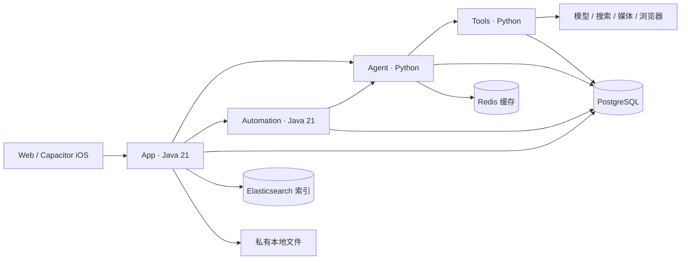

<div align="center">


**可自托管的个人 AI 助手：记住偏好、安排每天的事，把任务持续做下去。**

[English](README.md) · [简体中文](README.zh-CN.md) · [体验界面](#体验界面) · [安装](docs/zh-CN/installation.md) · [参与开发](CONTRIBUTING.md) · [社区讨论](https://github.com/jiamingze/Adex/discussions)

[](https://github.com/jiamingze/Adex/actions/workflows/core.yml)
[](LICENSE)


</div>

Adex 将 **聊天、记忆、日程、笔记和后台任务** 放在统一的 Web／iPhone 工作空间中。你可以在自己的机器上部署，接入自己的模型，隔离不同用户的数据；也可以沿着完整的 Java／Python 后端学习可靠 Agent 的实现。

- **记住值得保留的信息。** 模型根据语义将口语偏好整理成事实，后续对话可参考；支持查看、纠正、遗忘和关闭。
- **离开页面也继续执行。** 定时简报与后台任务持久保存，中断后恢复，结果回到原来的会话。
- **关键操作由你决定。** 网页任务可在聊天里请求登录、展示待提交文章、等待确认，并核对执行回执；真实商家流程仍需外部验证。

**当前为开发预览。** 没有公开托管服务或 App Store 下载。界面演示均为合成数据；真实模型、Google OAuth、APNs 和媒体生成需要自行配置，能力受供应商权限影响。[查看已验证范围与阻碍](docs/IMPLEMENTATION_STATUS.md)。

## 一个组织日常事务的工作空间

| 今日 | 聊天 | 待办 | 笔记 |
| --- | --- | --- | --- |
| [](docs/images/gallery/today-mobile.jpg) | [](docs/images/gallery/chat-mobile.jpg) | [](docs/images/gallery/tasks-mobile.jpg) | [](docs/images/gallery/notes-mobile.jpg) |

390×844 响应式 Web，账号与内容均为虚构，不代表 iPhone 原生功能已通过真机验收。[更多截图与复现方式](docs/product/screenshot-gallery.md)。

## 体验界面

**无需模型 Key、数据库、Java 或 Xcode。** 安装 Node.js 22、pnpm 10.11.0、uv 和 Python 3.12+ 后：

```bash
git clone https://github.com/jiamingze/Adex.git
cd Adex
make demo-ui
```

打开 **http://127.0.0.1:18117/today?fault=calendar-plan**，浏览今日、聊天、待办、笔记。Ctrl+C 停止。此服务仅监听本机并提供静态合成响应，**不调用模型、不持久保存笔记、不执行外部操作**。不要输入真实凭据，不要通过隧道公开，也不要作为正式部署使用。

## 运行完整应用

按 [安装指南](docs/zh-CN/installation.md) 选择 macOS／Ubuntu 本地开发或 Docker Compose。本地开发需要 Java 21、Maven、Node.js 22、pnpm 10、Python 3.12+、uv、PostgreSQL 16、Redis；FFmpeg 用于媒体样例和拼接。请以普通用户运行。

```bash
make doctor
make setup
uv run python scripts/init_env.py
# 编辑生成的私有 .env：选择 Mock，或填入自己的供应商配置。
make build
make up-dev
make status
```

打开 **http://127.0.0.1:5173**。访客可聊天；注册账户可使用私有附件和持久任务。初始化账号信息在自己的 `.env` 中，没有共享默认密码。`make down-dev` 停止业务进程，不删除数据。

iOS 使用同一套 React 界面和 Capacitor。[在 Mac 上构建签名](docs/zh-CN/installation.md#安装到-iphone)，需要自己的 Apple Team 和手机能访问的 HTTPS 后端；免费签名需定期续签。安装项目依赖不要求配置 iOS 或临时隧道。

## 可以尝试什么

| 需求 | 结果与依赖 |
| --- | --- |
| “我喜欢安静的地方，行程安排宽松一些。” | 语义记忆将偏好整理成简洁事实；可在个人记忆里修改／遗忘。语义理解需要真实模型。 |
| “每天早上八点整理最新的 SpaceX 消息。” | 确认带时区的定时任务，后台执行并将结果送回聊天；实时新闻需要 Tavily。 |
| 一起安排今天 | 汇总待办、会议与任务结果；iPhone 日历需要系统授权，Google 需要 OAuth。 |
| 修改自动安排 | 点击任务右侧铅笔，修改内容、频率／时区和通知条件；版本校验后更新后续执行，保留历史记录。[说明](docs/architecture/schedule-editing.md) |
| 重要待办提醒 | 重要、未完成事项在截止前 10 分钟提醒，复用持久调度与已配置的 APNs 通道；完成、删除或改期后抑制旧提醒。 |
| “明天天气怎么样？附近有哪些酒店？” | 经同意按需使用近似位置，也可手动选择城市；天气和地点推荐使用真实查询证据，不后台追踪。 [位置说明](docs/architecture/location-context.md) |
| “每10min帮我巡检最新公告。” | 聊天创建间隔任务并返回真实回执；巡检抑制连续相同结果的通知，保留每次执行记录。 |
| 推进一个长期目标 | 让 AI 拆解可编辑计划，确认后创建真实待办；目标进度随待办完成更新，活动记录可回到原会话。 |
| 保留有价值的回复 | 一键整理成有标题的私有笔记，支持 Markdown 阅读、源码编辑／预览、搜索与置顶。 |
| 准备网页文章 | 服务端浏览器、会话内登录／接管、冻结请求审批与回执核验。真实小红书／淘宝兼容性仍为 **BLOCKED_EXTERNAL**，需账号实测。 |
| 绘图或创作图片、原创音乐和视频 | 可编辑图形与私有作品；真实媒体生成需要供应商配置及权限，Mock 会明确标注。 |

还包括 Qwen／MiniMax 切换、自动 Tavily 搜索、Markdown、附件、停止／重试和历史会话。Google Calendar／Gmail 与 APNs 已有适配器和测试夹具，夹具不等于真实账户修改或通知送达。音乐目录检索提供官方跳转，检索权限不等于全曲播放授权。

<details>
<summary><strong>会话内网页操作 · 合成演示</strong></summary>

  

凭据只作为瞬时控制数据，不进入模型和消息；可选保存七天可撤销的加密登录会话，不保存输入密码。验证码／多因素验证及自定义控件可能需要接管。不确定的结果走对账，不盲目重发。[设计与边界](docs/architecture/browser-operator.md)。

</details>

## 支撑可靠执行的后端



四个业务服务独立管理 PostgreSQL 数据域，接口验证用户归属。普通聊天直接调用 Agent；长任务复用 Automation 的租约、fencing、不可变 Checkpoint 和 outbox。Tools 使用幂等效果账本处理外部执行与不确定结果。L1 工作态／L2 会话／L3 长期记忆生命周期分离，删除事实不能被旧提取任务或索引恢复。

任务工具回执、分步研究循环和自动记忆召回的实现与边界，见 [Agent 内核设计](docs/architecture/task-action-kernel.md)。研究沿用现有 Run/lease/checkpoint；未核实验收项明确为部分完成。

支持服务独立部署和多实例协调。附带 Compose 是**单机起点**，不等于自动高可用；一期文件保存在 App 管理的持久本地磁盘，多主机 App 需要明确文件路由或经批准的共享存储设计。[技术架构](docs/zh-CN/architecture.md) · [工程边界](docs/architecture/engineering.md) · [文件存储](docs/LOCAL_FILE_STORAGE.md)。

## 从哪里开始读代码

| 路径 | 职责 |
| --- | --- |
| `apps/web`、`apps/ios` | React／TypeScript、Capacitor 与原生桥 |
| `services/adex-app` | 认证、会话、记忆、文件及公共 API |
| `services/adex-agent` | 路由、上下文、模型调用与检查点 |
| `services/adex-automation` | 定时任务、持久 Run、领取与结果交付 |
| `services/adex-tools` | 供应商、连接器、审批、效果账本及隔离 Runner |
| `packages`、`migrations`、`deploy` | 共享契约／内核、独立数据域和部署 |

[安装](docs/zh-CN/installation.md) · [配置](docs/zh-CN/configuration.md) · [开发与学习路线](docs/zh-CN/development.md) · [IDE](docs/zh-CN/jetbrains.md) · [运维](docs/RUNBOOK.md) · [记忆](docs/architecture/conversational-memory.md) · [连接器与推送](docs/architecture/proactive-assistant.md) · [Skills](docs/architecture/skills.md) · [路线图](ROADMAP.md) · [更新记录](CHANGELOG.md)

## 一起参与

欢迎文档、可访问性、移动端问题复现和供应商夹具等小而明确的贡献。[选择入门任务](docs/project/starter-tasks.md)，阅读 [贡献指南](CONTRIBUTING.md)，或 [创建 Issue](https://github.com/jiamingze/Adex/issues/new/choose)。支持中文或英文，并非所有贡献都需要付费模型或 iPhone。

```bash
make test
make check-style
make test-integration
uv run python scripts/check_secrets.py
```

集成测试使用隔离数据库和明确标注的外部夹具，不使用个人 Key；真实供应商验证需自行选择并限制费用。请遵守 [社区规范](CODE_OF_CONDUCT.md)，通过 [SECURITY.md](SECURITY.md) 报告安全问题。

[MIT 许可证](LICENSE)。独立项目，与 OpenAI、阿里云和 MiniMax 无隶属关系；名称仅表示适配，依赖和内容保留各自权利。


## 一起完善 Adex

[社区欢迎帖](https://github.com/jiamingze/Adex/discussions/1) · [安装问答](https://github.com/jiamingze/Adex/discussions/categories/q-a) · [可认领的入门任务](https://github.com/jiamingze/Adex/issues?q=is%3Aissue%20is%3Aopen%20label%3A%22good%20first%20issue%22)

如果 Adex 对你有帮助，欢迎点一颗 Star，让更多人发现它。也欢迎分享自己的使用场景、安装经验和作品；一个可复现的问题或聚焦的 PR 同样有价值。


新版工作空间统一为 **今日 / 对话 / 任务 / 资料**：聚合待核对操作、按截止日期组织待办、集中查看自动安排与执行记录，保存笔记及私有报告、文件。相关对话可读取当前账户的待办、笔记摘录、自动任务，以及已授权的 iPhone 系统日历。数据范围与临时快照清理机制见[体验契约](docs/architecture/unified-assistant-experience.md)。
