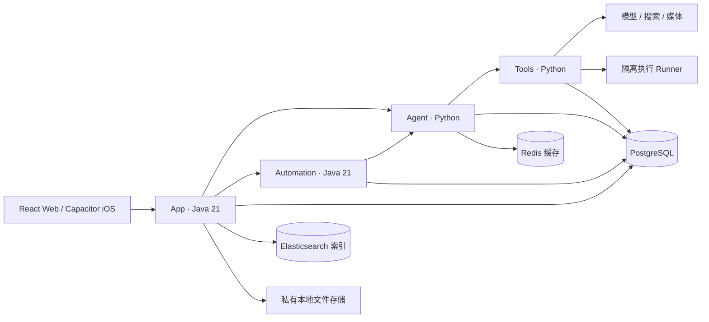

<div align="center">


**个人 AI 工作空间：聊天、记忆、创作与定时执行。**

[English](README.md) · [简体中文](README.zh-CN.md) · [安装指南](docs/zh-CN/installation.md) · [技术架构](docs/zh-CN/architecture.md) · [参与贡献](CONTRIBUTING.md)

[](https://github.com/jiamingze/Adex/actions/workflows/core.yml)


</div>

Adex 是可自行部署的个人 AI 助手，Web 与 iOS 共享一套界面。它把对话、持续记忆、联网搜索、附件问答、定时任务和创作作品连接在同一个工作空间中，也为学习 AI 应用工程提供可阅读的完整项目：数据库权限边界、三层记忆、Checkpoint、任务租约、幂等工具调用和结果回流都有对应实现。

**项目阶段：早期开发，持续迭代。** 已有可运行服务和测试，但不代表全部功能已达到生产验收标准。真实模型能力需要配置自己的供应商凭证；具体证据与限制见 [实现状态](docs/IMPLEMENTATION_STATUS.md) 和 [验收记录](docs/ACCEPTANCE_EVIDENCE.md)。

## 功能

| 模块 | 使用体验 |
| --- | --- |
| 聊天 | 流式回复、Qwen / MiniMax 切换、Markdown、历史删除、停止与重试 |
| 联网搜索 | 根据问题自行搜索最新资料，通过 Tavily 返回来源 |
| 记忆 | 工作态、会话和长期记忆；查看、纠正与删除 |
| 定时执行 | 从聊天创建每日任务，管理任务和运行记录，结果回到原会话 |
| 创作 | 研究报告、旅游行程、沙箱 HTML 游戏、可编辑图形与媒体作品 |
| 原创音乐与视频 | 配置真实模型后生成，保存私有作品、播放和下载 |
| 附件 | 图片、文档上传与问答；iOS 原生相册和语音桥接 |
| 作品空间 | 文件权限、版本历史、预览与导出 |

图片生成是否可用取决于适配器配置。Mock 媒体明确标注为测试样例，不会冒充真实生成结果。商业音乐目录只能跳转授权平台，检索结果不等于站内播放授权。iOS 相册上传、麦克风识别和键盘交互仍需按实际设备验证，最新边界记录在实现状态文档中。

## 示例界面


<details>
<summary>展开 iOS 界面</summary>


截图来自开发环境的测试示例，不是在线公共演示服务。截图中的测试任务已在验证后取消。
</details>

## 快速开始

需要 Git、Java 21、Maven、Node.js 22、pnpm 10、Python 3.12+、uv、PostgreSQL 16 和 Redis。本地基础设施脚本支持 macOS/Homebrew 与 Ubuntu PostgreSQL 16 路径，使用普通用户运行。

```bash
git clone https://github.com/jiamingze/Adex.git
cd Adex
make doctor
make setup
uv run python scripts/init_env.py
```

初始化会生成 `.env` 中的私有密码和服务凭证，已有配置不会被覆盖。仅学习代码时，可在 `.env` 设置 `ADEX_MODEL_PROVIDER=mock`、`ADEX_MUSIC_PROVIDER=mock`，无需真实模型 Key；测试回复会明确标注。真实聊天配置 MiniMax 或 Qwen，联网搜索另行配置 Tavily，详见 [配置说明](docs/zh-CN/configuration.md)。

```bash
make build
make up-dev
make status
```

打开 **http://127.0.0.1:5173**。访客可以聊天，附件、定时和创作需要注册或登录。初始化账户凭证保存在自己的 `.env`，项目没有公开通用密码。

```bash
make down-dev
```

依赖安装、Docker Compose、iOS 签名及排错请阅读 [完整安装指南](docs/zh-CN/installation.md)。外网访问需使用有身份验证的 HTTPS 网关，数据库与内部接口不能直接公开。

## 技术结构



四个业务服务分别拥有自己的数据边界。PostgreSQL 是权威存储，Redis 和 Elasticsearch 可重建。普通聊天保持交互式执行，耗时任务交给 Automation，通过租约、fencing epoch、Checkpoint 和 Outbox 恢复与交付。详见 [技术架构](docs/zh-CN/architecture.md)。

## 目录与学习路线

| 目录 | 内容 |
| --- | --- |
| `apps/web` / `apps/ios` | React 客户端、Capacitor 容器和 Swift 桥接 |
| `services/adex-app` | 账户、聊天、记忆、文件及公共 API |
| `services/adex-automation` | 调度、持久任务、租约与结果交付 |
| `services/adex-agent` | 意图路由、上下文、模型和 Checkpoint |
| `services/adex-tools` | 联网、旅游、研究、媒体和工具效果账本 |
| `packages` / `migrations` | 共享 UI、契约、内核和分域数据库迁移 |
| `runners` / `deploy` | 隔离执行、Compose、镜像和网关 |
| `scripts` / `docs` | 环境初始化、测试、备份恢复、设计和验收证据 |

推荐先阅读 [开发与学习指南](docs/zh-CN/development.md)，再从 `apps/web/src/api.ts` 追踪 `ChatStore`、`ChatWorker` 到 Agent 入口，最后学习自动化调度和工具幂等。

## 测试

```bash
make test
make test-contract
make test-integration
uv run python scripts/check_secrets.py
```

集成测试使用独立 `adex_test_*` 数据库与 Mock 外部能力，不用个人 Key 执行付费模型请求。部分检查需要 Docker 和本机基础设施。

## 更多文档

- [安装](docs/zh-CN/installation.md)、[配置](docs/zh-CN/configuration.md)、[开发](docs/zh-CN/development.md)
- [运维与恢复](docs/RUNBOOK.md)、[文件存储](docs/LOCAL_FILE_STORAGE.md)
- [路线图](ROADMAP.md)、[更新记录](CHANGELOG.md)、[安全说明](SECURITY.md)
- [原始设计](docs/Adex_Product_Technical_Design_v4.1.md)、[验收门禁](docs/ACCEPTANCE.md)

## 一起参与开发

欢迎大家一起把 Adex 做得更好，无论你是刚开始学习，还是有工程经验，都可以参与代码开发、界面设计、设备测试、文档完善和需求讨论。可以先看看 [路线图](ROADMAP.md)、[现有问题](https://github.com/jiamingze/Adex/issues) 和 [贡献指南](CONTRIBUTING.md)。较大的功能建议先开 Issue 讨论范围，小修复和文档改进欢迎直接提交 PR。

欢迎提交可复现问题、设备测试、供应商适配器和文档改进。参与前请阅读 [贡献指南](CONTRIBUTING.md)。安全问题请按 [安全策略](SECURITY.md) 私下报告。

Adex 独立开发，不隶属于 OpenAI、阿里云或 MiniMax。供应商名称仅用于说明集成。项目采用 [MIT](LICENSE) 许可证，依赖及生成内容遵守各自适用的许可和权利。
