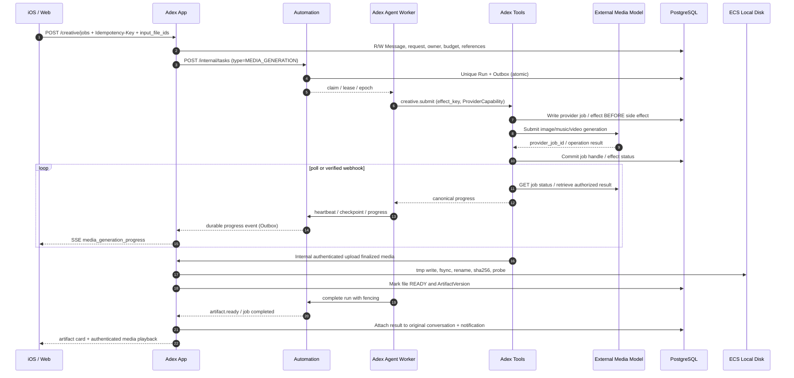

# Adex v4.1 · Creative Media Design / Codex Implementation Guide

> Canonical full specification: `Adex_Product_Technical_Design_v4.1.md` sections P1-14/P1-15. If there is a discrepancy, use the full specification. Models are user-supplied in a later integration step; no credentials or SDK are present yet.


## P1-14 · 多模态创作能力（图片、架构图、原创音乐、视频）

### 产品范围、差异化与交互

| 能力 | 用户样例 | 交互卡 | 一期必要动作 | 作品可编辑资产 |
| --- | --- | --- | --- | --- |
| Image Generate/Edit | “画一张亲子旅行封面”、“把这张照片背景换成雪山” | `image_gallery` / `image_editor` | 文生图、图生图/编辑、查看大图、变体/修订、下载 | Prompt、参考图、编辑遮罩可选、输出图片与父版本 |
| Diagram Drawing | “画 Adex 四服务图，标上 PG/Redis/ES 调用” | `diagram_editor` | 架构/流程/时序图、实时预览、源码/节点修改、SVG/PNG 导出 | **DiagramSpec JSON + Mermaid（权威可编辑源）**，渲染产物 |
| Original Music Generation | “生成 30 秒轻快旅行 BGM” | `generated_audio_player` | 风格/长度/人声参数、状态、播放、下载、修订 | 参数、生成音频、版本、音频元数据 |
| Video Generation | “把上传照片做成 5 秒动画” | `generated_video_player` | 文生/图生、进度、播放、下载、修订/可取消 | Prompt、参考图、视频、封面、版本 |

- **搜索已有歌曲 (`MusicCatalogProvider` / `PlaybackProvider`) 和制作原创音乐（`MediaGenerationProvider` 的 `MUSIC_GENERATE` 能力）完全是两个产品域**。前者涉及商用曲库权益，后者受生成模型与合法使用条款约束；不得合并接口或误导用户。
- 编辑既包括对现有作品调用模型生成新版本，也包括对**架构图源文件的确定性编辑**。图片/视频/music 的“编辑”以接入 Provider 支持的能力为准，不能假装某个模型支持局部修改/音频分轨/视频剪辑。
- iOS/Web 共用 UI 卡：`media_generation_progress` 要显示 `QUEUED/RUNNING/FINALIZING/SUCCEEDED/FAILED/CANCEL_REQUESTED/CANCELED/UNKNOWN` 状态、已耗时、成本/剩余额度、参考输入、最近错误码，并可返回原会话。
- 首次图片/视频/音乐执行可以提示模型供应商、素材使用范围、最大时长/分辨率以及费用上限，用户更改设置后形成新 request revision。
- 用户要求“画架构图”时，默认输出**结构化可编辑图**而非单张 AI 图片，因为后续可精确调整服务节点、接口与连线；用户明确要艺术风格架构插画时可走图片生成，但不替代可编辑图。
- 生成媒体仅来自用户授权输入或合规模型输出，明确禁止无授权使用受版权保护录音做分发、非自愿声纹/肖像冒用；生成结果标明模型来源与必要的合成标识，遵守模型及部署地域要求。

### 作品空间与版本管理

- 统一 `Artifact`（稳定 ID、owner、origin_conversation_id、kind `IMAGE|DIAGRAM|GENERATED_AUDIO|VIDEO`、current_version_id）和不可变 `ArtifactVersion`（parent_version_id、source_job_id、input_refs、output_file_ids、edit_source_file_id、prompt、params、model_id/version、provenance、created_at、visibility）。版本内容属于 App；数据库记录与文件均不能原地覆盖已发布版本。
- 媒体文件必须复用 **ECS `LocalFileStorage`**：`/data/adex/files/{images,videos,audios,artifacts,tmp}`，经过 App File API 写入 `PENDING→READY`，保存 sha256/MIME/size/width/height/duration/codec/ACL；缩略图/海报帧/波形是衍生资源，需版本归属和生命周期引用计数。
- `GET /api/v1/files/{id}/content` 为鉴权流；音视频按 Range 返回 206 以支持拖动进度，图片按缓存/ETag；**不把生成文件放在 Nginx 公共静态目录，绝不将未授权的 provider 临时下载 URL 直接回给客户端**。
- 架构图编辑源 `.mmd`、`diagram.json` 与 SVG/PNG 预览同时保存；渲染器版本和安全策略随 ArtifactVersion 记录。Mermaid SVG 必须清洗潜在脚本、链接和不安全 HTML，使用隔离策略。
- 若文件发布成功而事务未提交，孤儿扫描按保留期清理；若 PG 引用未完成文件，作品不进入 `READY`。删除作品执行墓碑 + 异步安全回收，备份和操作审计遵循原 v4.0 存储规范。

## P1-15 · 多模态生成执行架构、接口与可靠性

### 四服务职责、API 调用与数据落点

| 组件 | 接到什么请求 | 调用什么 | 读写什么 |
| --- | --- | --- | --- |
| iOS/Web | 用户发送文生图/音乐/视频/画图请求或点击修订 | 只调 App `/creative/jobs`、`/diagrams`、`/artifacts`、`/files`；SSE 获取进度 | 本地仅短期预览状态，不存长期原件 |
| **adex-app** (Java) | 消息、创建与读取媒体任务、上传参考素材、展现作品 | App → Agent 解释创作意图；App → Automation 建持久 Run；完成后接 `artifact.ready` 事件 | PG 消息/Artifacts/Files/版本/通知；LocalFileStorage 文件；Redis 热态；ES 仅异步索引标题/描述（不存二进制） |
| **adex-agent** (Python) | 解释 Prompt、选择图/图像/音/视频工具与 Provider、参数归一 | Agent → Tools `diagram.*` / `creative.*`；长任务由 Automation 驱动 Agent 后台 Worker | Agent PG Checkpoint/模型审计；不直接拥有 App 文件/作品表 |
| **adex-automation** (Java) | 长时媒体 Job/重试/恢复与回调状态变化 | PG 事务创建 Run/Occurrence/Outbox、Claim/Lease/Epoch、将合法完成事件触达 App | Automation PG Task/Run/Step、ProviderJob 映射/预算/状态/Outbox；Redis 仅可做唤醒 |
| **adex-tools** (Python) | MediaGenerationProvider、Mermaid 校验/渲染、模型回调解析、媒体探测 | 第三方模型 API；受控抓取输出资源，再通过 **App 内部 File API** 上传完成文件；如处理长视频可调用独立 Runner | Tools PG provider_effects / idempotency / external job ID / audit；临时磁盘；正式资产由 App 接管 |

**状态与流程**：`REQUESTED → QUEUED → RUNNING → FINALIZING → SUCCEEDED`；异常路径 `FAILED_RETRYABLE / FAILED_FINAL / UNKNOWN / CANCEL_REQUESTED / CANCELED`。状态变更均条件 CAS + `run_id/attempt_id/epoch`。`UNKNOWN` 不代表失败，更不能立即重新下单。轮询和 Webhook 可并存；**Webhook 必须验证签名与时效**并经版本号/事件 ID 去重，回调可能乱序、重复或迟到，必须忽略回退状态。



### 可插拔模型能力协议（待用户提供 API 后接入）

```python
from typing import Protocol

class MediaGenerationProvider(Protocol):
    async def capabilities(self) -> dict: ...
    async def submit(self, *, kind: str, prompt: str, input_refs: list[str],
                     params: dict, request_key: str) -> dict: ...
    async def get_status(self, *, provider_job_id: str) -> dict: ...
    async def get_result(self, *, provider_job_id: str) -> dict: ...
    async def cancel(self, *, provider_job_id: str) -> dict: ...
    async def reconcile(self, *, request_key: str, provider_job_id: str | None) -> dict: ...
```

- `kind = IMAGE_GENERATE | IMAGE_EDIT | MUSIC_GENERATE | VIDEO_TEXT | VIDEO_IMAGE`；架构图默认独立 `DiagramProvider`（LLM→DiagramSpec→validate→render），**不需要多模态模型**。能力发现字段必须包含支持的 kind、输入 MIME/文件大小、尺寸比例、时长、是否原生异步、是否可取消、是否有查询/幂等、收费单位、区域/安全策略。无能力时返回 `UNSUPPORTED_CAPABILITY`。
- **统一结果协议**：同步模型也正规化成一次终态 job；异步 Provider 保存 `provider_job_id`、`provider_request_key`、`model_id`、`provider_config_version`、`status`、`next_poll_at`、`attempt`、`estimated_cost/actual_cost`、`output_metadata`。**禁止把 Provider Key 暴露给用户或写到 LLM Prompt**；配置经 Tools Vault/服务密钥管理。
- 缺真实 API 时提供 `MockMediaGenerationProvider`，自动化契约测试覆盖 job 状态、超时、重复回调、未知结果、模型错误、取消、引用丢失、权限检查；用显式受权 fixture 进行播放验收，并标注 `BLOCKED_EXTERNAL`。之后新增实际 provider 适配器，不动公共 API、四服务数量、作品 Schema。
- 生成请求幂等键应基于 owner/request_id；外部 `submit` 的稳定 `effect_key = media-job:{job_id}:submit`，且必须**先持久化准备提交状态再调用供应商**；当 `submit` 响应丢失但外部可能接单，先 `reconcile` 查询外部，不得在无法判定时继续自动提交导致重复生成或重复收费。
- 回调仅作为 job 状态通知，**最终产物拉取由 Tools 控制**。所有外部下载地址必须做 SSRF 防护（URL 白名单/重定向检查/私网阻断），限制解码大小、视频时长、尺寸、MIME，使用超时、断点与容量配额，并记录内容指纹。回调不直接绕过 Owner/ACL 写 App DB。
- 取消请求只保证停止 Adex 后续处理与尝试调用模型取消；供应商可能已生成且已计费，必须在状态与成本提示里明确。恢复中若文件已 READY 而 ArtifactVersion 尚未发布，用稳定 key 补写版本，不重复下载/重复计费。
- 生产媒体保留原始文件，不要只留缩略图；发布前进行权限、许可、基础内容风险检查；作品元数据包括生成/编辑来源、输入引用、模型版本、Prompt 参数、生成时间、输出格式、可复现局限性。用户可删除作品并追踪清理衍生件。

### 实体主键与幂等索引约束（Codex 必须实现）

- App `creative_artifacts(artifact_id PK, owner_id, kind, current_version_id, origin_conversation_id)`；`artifact_versions(version_id PK, artifact_id FK, parent_version_id, source_job_id, prompt_json, params_json, output_file_id, source_file_id, created_at)`；新增作品版本插入必须不可变。`UNIQUE(artifact_id, source_job_id)` 可用于消除重复完成事件，多个输出图时应扩展为 `(artifact_id, source_job_id, output_index)`。
- Automation `creative_jobs(job_id PK, run_id UNIQUE, owner_id, kind, status, budget, provider_status, created_at)`；主用户提交 `UNIQUE(owner_id, idempotency_key)`；外部 provider job 索引允许重试后的版本变化，但必须限定 `(provider, provider_job_id)` 非空唯一。
- Tools `media_provider_effects(effect_key UNIQUE, job_id, provider, provider_request_key, provider_job_id, status, last_event_id, next_poll_at, error_code, observed_at)`；同一 provider webhook 的事件 ID 单独唯一约束并保存签名验签结果；接管之后旧 Attempt 无权将过期结果发布。
- App `files` 已有表作为所有生成二进制真实 owner；每个 `artifact_versions.output_file_id` 必须指向 READY 文件；不可跨域直接使用另外服务的 schema 改写数据。
- 独立 `creative.job.progress` / `creative.job.completed` Outbox 事件至少有 `event_id, schema_version, owner_id, job_id, run_id, origin_conversation_id, status, artifact_version_id?, occurred_at`，消费方 `(consumer_name,event_id)` 去重；回流原会话时 `dedupe_key=creative-complete:{job_id}` 唯一。

### 首期性能、安全和验收

- 单 ECS 不运行音视频大模型推理，**阿里云只调用用户将提供的多模态模型服务**；音视频文件按流写本机独立持久化数据盘，避免把大视频一次性加载进 Java 堆/Redis/PG。可选后台 ffprobe/ffmpeg/安全预览 Runner 设 CPU/内存/时长上限。
- 图片可配置尺寸/张数，音乐时长、视频分辨率/时长均由实际 Provider Capabilities 驱动，而非前端写死。统一预算、用户配额和最大磁盘容量阈值，越界拒绝新任务但不破坏已有文件。
- iOS 免费签名不影响通过 HTTPS 获取授权文件并播放常见兼容格式；具体支持的 codec/MIME 应在真机验收，支持不可播放时提供下载/外部打开退化路径。
- 6 个新增测试（ACC-21～ACC-26）：图源码可编辑/可导出；图片生成/编辑链路；原创音乐播放；视频长任务与重启恢复；重复 Provider 回调/UNKNOWN/幂等；媒体/磁盘/访问隔离与备份恢复。**所有外部真实生成在模型 API 提供前记为 BLOCKED_EXTERNAL，不把 Mock 通过当作“真实生成完成”**。

## Milestone implementation notes

- M12: `packages/ui-schema` diagram card schema; Agent DiagramSpec generator; Tools pure validator/isolated renderer; App source & version; build tests for Mermaid parser, XSS and renderer version; no media provider needed.
- M13: `MediaGenerationProvider` capabilities + job flow, input refs, image generation & edit. Mock first then optional real adaptor configured by capability; safe file promotion and revision.
- M14: audio creation job, MIME/probe, authenticated playback with Range, tracks separate from commercial catalog, no unauthorized master streaming.
- M15: long video async generation, signed webhook+poll fallback, provider effect/state reconciliation, thumbnail poster, Range and device compatibility test.
- M16: end-to-end media backup restore and fault injection plus all earlier platform acceptance gates.
