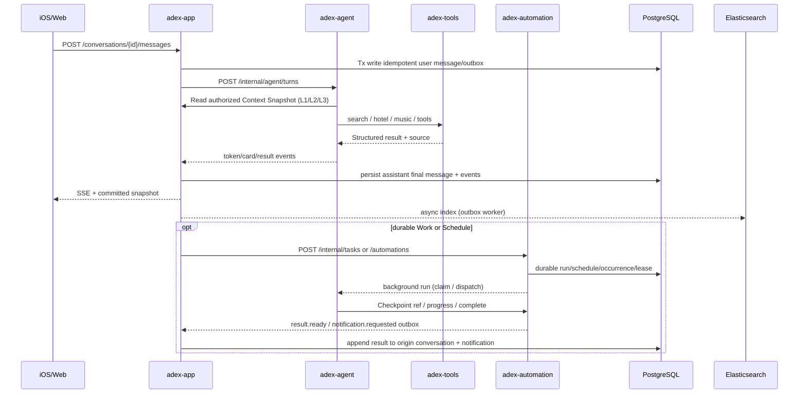

# Service ownership and contract-first API

This document is supplementary; the full v4 design contains the exact Phase1 API matrix and older v3.1 internals.

- App owns identity, conversations, 3-level user Memory and UI/notification records.
- Agent owns intent, orchestration, model calls and computation checkpoints; does not mutate App/Automation data tables.
- Automation owns Schedule/Monitor/Task/Run/Step/Lease/Fencing and reliable notification intents.
- Tools owns tool registry/connectors/credentials/effect ledger/runner; external side-effect operations require stable effect keys.
- All public calls enter App; internal APIs require scoped service authentication.
- Core API candidate: `packages/contracts/openapi-phase1.yaml` is a **design starter**, not a complete implementation or proof of HTTP endpoints.

## Creative media and editable diagrams (v4.1)

- Public App API: `GET /creative/capabilities`, `POST /creative/jobs`, `GET /creative/jobs/{job_id}`, `POST /creative/jobs/{job_id}:cancel`, `POST /creative/artifacts/{artifact_id}:revise`, `POST /diagrams/validate`, `POST /diagrams/render`. See OpenAPI starter for schemas and required idempotency keys.
- **Run/Provider job** is Automation-owned and durable; `MediaGenerationProvider` implementation is Tools-owned, model prompt planning remains Agent-owned; App owns file and artifact/version authoritative data.
- Image/video/music generation is NOT available from a model provider until the user supplies real credentials/documentation. Implement mocks and contract tests, mark real tests `BLOCKED_EXTERNAL`.
- Diagram source/editing works without a multimodal API through validated Mermaid/DiagramSpec and isolated renderer.
- Provider's generation status is not the same as publication status; artifact READY requires saved local file + App PG reference. If provider completed but App failed, recovery must finish publishing without another provider submit.

### Alibaba media production adapters (2026-10-11)
Qwen Audio `qwen-audio-3.1-tts-next` uses the Beijing workspace HTTPS SpeechSynthesizer API for original music, 1–120 seconds per request. Longer requests (up to 600 seconds) use independently durable original sections and two-second crossfades; each section remains at most 120 seconds. Persist the composition coordinator ID before child submission, reuse completed child files on recovery, and never repeat UNKNOWN child submissions. Wan video uses the same workspace with durable remote task ID and query-only reconciliation. Both produce privately owned App files and playable conversation cards; no provider URL is exposed to the client. Music duration is recorded from the provider response.

## Read-only server browser (2026-10-11)

`POST /internal/browser/read` requires Agent `search:read` scoped to the owner, consumes search budget, accepts `{url, query}` and returns timestamped `BROWSER_RENDERED_PAGE` source items. Only configured public HTTPS hosts may be read. The runner receives no service/model credentials, opens an ephemeral headless Chromium context, pins public DNS addresses, intercepts each request, blocks writes/downloads/WebSockets/service workers and has a bounded lifetime. Browser page text is untrusted evidence, never execution authority. Ordinary search can automatically select the browser for GitHub lookups and explicit supported URLs.

Image chat requests route to an Automation IMAGE task. DashScope Qwen-Image receives the original prompt, returns a provider result that is imported via App File API, and publishes an authenticated image card. Provider permission failures remain explicit; mocks never count as real generation.

Stopping a chat commits CANCELLED and fencing epoch first. Each App replica polls active ownership and interrupts/closes stale streams, with an overall response deadline. A completed background media task has its own task cancellation control.

Chat model budgets: `ADEX_DAILY_MODEL_CALL_LIMIT=0` disables the daily reply count cap while retaining durable usage accounting. Positive limits remain configurable for hosted deployments. Media and search budgets are separate.
