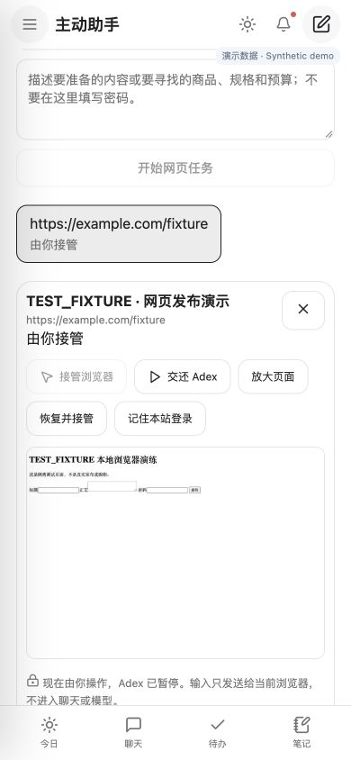

# Generic browser operator — implementation contract

## Actual gap

Before this change browser access was stateless/read-only. This implementation adds
interactive sessions, secure takeover, a page-action broker, request approvals and waiting Runs.
Existing shared action approvals/effects, Agent checkpoints, Automation leases and
outbox are authoritative and must be extended, not replaced. No per-site Skills.

## Migration list

- Tools 007: owner/Run-bound browser sessions, encrypted browser state and pending
  request material, revision and runtime binding. Existing approvals/effects reused.
- Automation 006: outbox logical delivery keys so waiting and final events can both
  reach the original conversation. WAITING_INPUT uses the existing Run/attempt tables.
- No new business service, task scheduler, credential service or artifact filesystem.
  Screenshots are transient authenticated responses; browser state is encrypted JSON,
  not a public file. App still owns persistent files and media.

## Contracts

App endpoints: GET `/browser/sessions`; POST `/browser/sessions/{id}/control`
with bounded human operations; POST `/browser/sessions/{id}/resume`; POST
`/browser/sessions/{id}/close`. Owner authentication precedes Tools calls.
Session snapshots expose URL/title/screenshot and redacted AX observations, never
cookies, passwords, raw CDP or arbitrary JavaScript. Human mode pauses Agent actions.

Agent uses Tools `/internal/browser/operator/ensure`, `/{session}/observe`, `/{session}/step`; dispatch uses existing `/internal/actions/execute`;
all Agent mutations require live Automation Run/epoch/attempt authorization. Step
handles bind to a current observation and backend DOM node, not site-specific XPath.
Model output is constrained JSON, not executable code. Supported actions are navigate,
click, type, select, scroll, back, upload, switch_tab and handoff. No site scripting tools.

Every non-read HTTP request in Agent mode is held before sending. The immutable
request digest, originating page/form preview and destination become an existing
Action Approval. User approval resumes the same Run. Effect IN_FLIGHT and approval
UNKNOWN are committed before the held request is released. Lost browser requests are
not replayed. HTTP success alone is submitted/unverified; business success requires
independent response/readback evidence. Unknown results remain UNKNOWN and block
blind re-execution. Critical GET gestures are also gated; ambiguous actions require
human review. This is defense in depth, not proof that all websites implement GET safely.

Browser contexts are per owner/Run. Secure manual input goes only to the broker, not
model/checkpoint/logs. Login may be done by the user in takeover mode; user can resume
or revoke the session. Cookies persist only in an encrypted vault envelope. Public-DNS
pinned egress rejects private destinations; login/navigation domains remain visible.

## Implementation and acceptance

1. Contracts/migrations and policy tests.
2. Controlled persistent Chromium broker and encrypted Tools session service.
3. Existing Run suspend/resume/outbox and generic Agent observation/action loop.
4. App authenticated gateway and mobile takeover/approval interface.
5. Isolated PG/HTTP and local-browser tests, build/style/security gates, public-page
   smoke, then device packaging where available.

Real Xiaohongshu publication, Taobao orders and payment remain BLOCKED_EXTERNAL until
an authorized account/merchant flow has been exercised and a verifiable receipt obtained.
Mock/local fixture success is never evidence of real publication, purchase or payment.
There is no universal success guarantee: CAPTCHA, merchant policy, MFA and unusual
widgets can require human takeover. Existing read-only browsing remains independent.

## Operating guide and boundaries

Open Assistant → Browser, provide a public HTTPS URL and instruction, or ask in chat
(e.g. “帮我在这个网址准备并发布文章 …”). Browser tasks require a registered user.
Select the task to see its page, take over login, and return control after the Run
has suspended. Secure input is sent to the broker; do not put passwords in chat.
The model receives redacted accessibility observations, never credentials or screenshots.
Popups are bounded to six tabs. Native browser dialogs require explicit human input.
Uploads use owner-authorized App File API content (5 MB maximum).

Set `ADEX_BROWSER_ENCRYPTION_KEY` to a dedicated random base64 32-byte key before
starting Tools; setup generates it for new installations. Missing key disables operation.
Keep the key in the deployment secret store. Rotation requires re-login; do not delete
it while sessions are expected to remain recoverable. “Remember login” is explicit,
encrypted and expires after seven days; one profile per user/domain. Revocation fences
stale saves and closes linked sessions. This clears Adex access, not the website’s own
server-side login session. Context storage may contain authentication cookies, not passwords.

Session runtimes are process-local and capped at four contexts, with 20-minute idle
cleanup on allocation. Multi-instance Tools deployments need session-affine routing.
A lost runtime requires explicit restore/takeover; an UNKNOWN write is never replayed.
A resource-command CAS prevents simultaneous controls; Automation remains the sole
Run scheduler and recovery authority. Headless Chromium uses sandboxing, the pinned
public-egress proxy and existing runner resource limits. Use container isolation in
production; local development is not a hardened hostile multi-tenant browser sandbox.

All mutating requests can include website analytics and intermediate writes, so complex
sites may require several approvals or human takeover. Binary/unparseable payloads
cannot be approved by the automated path. Request digests bind exact bytes, but generic
semantic understanding and readback verification are conservative heuristics, not a
universal payment or website adapter. GET side effects cannot be ruled out generically.
Only recognized business IDs newly present in independent same-site readback yield a
verified receipt; HTTP 2xx alone remains unverified. No payment-settlement verification
is implemented. MFA, CAPTCHA and payment authentication are human responsibilities.
Prompt-injected pages cannot approve requests or access a JavaScript/shell tool.

## Verification

`make test`, `make check-style`, `make test-integration`, web build and secret scanning
cover routing, narrow tool contracts, credential redaction, stale-page rejection,
real local Chromium request holding/release, owner isolation, profile revocation,
same-Run suspend/resume, outbox backfill and UNKNOWN reconciliation without resubmit.
The three operator integration scenarios use isolated PostgreSQL, mock planning and
an explicitly labelled local publisher fixture. They are not real merchant tests.

Real external publication/purchase/payment: **BLOCKED_EXTERNAL**. An operator must
validate each target flow with an authorized account and explicit final approval
before representing that integration as supported in production.

### Observed validation (2026-10-15)

- `make build`: Java package and TypeScript/Vite production build passed.
- `make test`: client suite, Java 9 tests, Agent 42 tests, Tools 62 tests and
  OpenAPI 90 operations passed. Subsequent Tools regression including malformed
  request-body handling: **63 passed**.
- `make check-style`: Spotless, Ruff formatting and architecture checks passed.
- `make test-integration`: **48 passed in 98.54 seconds**, including three operator flows.
- `uv run ruff check services/adex-tools/src/adex_tools/browser services/adex-tools/src/adex_tools/api/browser.py services/adex-agent/src/adex_agent/browser`: passed.
- `uv run python scripts/check_secrets.py` and `git diff --check`: passed.
- Direct real Chromium observation of `https://docs.python.org/3/`: title
  “3.15.0 Documentation”, 213 accessibility nodes, no pending write. This verifies
  public navigation only, not any login or merchant transaction.
- Mobile UI at 390×844: document/body width stayed 390px with normal and zoomed
  preview. iOS device build/install/launch succeeded; on-device merchant flows untested.

Reproduce the synthetic screenshot UI without private data:
`pnpm --dir apps/web build`, then
`uv run --project services/adex-tools python tests/fixtures/browser_operator_server.py`.
Open `http://127.0.0.1:18118/assistant` → Browser → synthetic session.

## In-conversation operator (2026-10-16 implementation contract)

Browser task cards become the control surface in the originating conversation:
progress, real-page-derived secure login, QR/MFA takeover, frozen draft approval,
and verified publication receipts. No lookalike site UI or invented login fields.
The current HTTPS destination is displayed; credentials are transient App→Tools→
Broker controls and never chat messages/model prompts/checkpoints. “Remember” stores
an encrypted, revocable seven-day session profile, not the typed password.

No migration or new scheduler: existing session snapshot carries bounded progress;
existing Run/lease/checkpoint/outbox and approvals/effects remain authoritative.
New App GET `/browser/runs/{run_id}` returns owner-checked Run state, exact session
and current approval (not a paginated list lookup). Tools provides its scoped Run
session lookup. Control extends `secure_login` with current origin/observation ID,
real field handles/values and an observed login-submit handle. Broker validates all
handles before typing, requires HUMAN mode, rejects publish/payment controls, and
clears user-entered values from exported state. Login remains human until the visible
login form is gone; resuming the same Run can then continue the model automatically.
QR/CAPTCHA/MFA remain actual website interactions in the inline page preview.

Publish approval shows full frozen title/body and destination; edits or navigation
invalidate the request digest/snapshot. Success requires existing response/readback
verification, not model prose. Return the submitted title and a provider-returned or
actually observed public permalink when available; never construct site URL templates
from an ID. If no permalink is available, say so rather than inventing one. Actual
Xiaohongshu/Taobao account flows remain BLOCKED_EXTERNAL until authorized end-to-end
validation; a local login/publisher fixture does not count as real external execution.

### Login and execution limits

Login field ownership is checked against native CDP document metadata before typing;
unavailable or cross-origin frame handles are rejected rather than guessed. Sites
with unsupported embedded identity providers, custom widgets or CAPTCHA can require
manual takeover. Credentials are cleared from client component memory after submit;
password-containing cookies/localStorage are removed before profile export. Session
tokens are still sensitive and encrypted at rest; revocation is revision-fenced.

Agent-approved mutating requests disable automatic HTTP redirects/retries. A redirect
or ambiguous result is not a reason to replay a write; the existing effect ledger
retains uncertainty for reconciliation. A platform-returned permalink is labelled as
not independently opened unless actual readback provides that evidence. These generic
heuristics do not prove every site's business semantics or payment settlement.

### Reproduce the chat UI

Build Web, run `uv run --project services/adex-tools python tests/fixtures/browser_chat_server.py`,
and open `http://127.0.0.1:18119/demo/login`, `/demo/review` or `/demo/done`.
This loopback-only gallery uses synthetic data and never publishes to a real account.
Screenshots in the README are from this gallery, not external execution evidence.

### Observed validation (2026-10-16)

`make build`, `make test` (Java 9 / Agent 45 / Tools 67 / OpenAPI 91),
`make check-style` and `make test-integration` passed; isolated integration suite:
**55 passed in 178.29 seconds**. Login→same-Run continuation→approval→verified local
receipt→new-task profile reuse is covered with synthetic credentials and an explicitly
labelled local Chromium fixture. Owner isolation, stale-origin rejection and credential
redaction are asserted. Registration tests reuse a synthetic identity rather than
weakening the production limiter. Ruff and secret/whitespace checks passed.

Mobile UI at 390×844 was exercised through login/review/completion and zoomed preview;
document/body width stayed 390px. Web and signed iOS device builds passed. Physical
installation was blocked by unavailable iPhone at verification time. Four local service
readiness checks returned 200. Real merchant flows remain **BLOCKED_EXTERNAL**.
