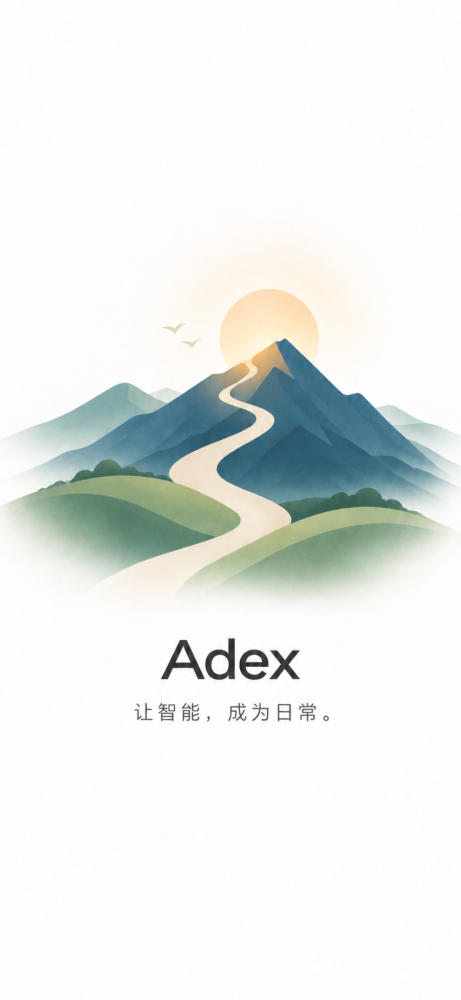

# Adex launch screen concept

White canvas, a restrained sage/ivory path toward morning light, charcoal Adex
wordmark, and “每一步，都算数。” (“Every step counts.”). The visual connects a
personal assistant's everyday actions with steady progress.

This AI-generated raster is a design concept, not an installed launch screen.
For implementation, keep system launch presentation brief, preserve safe areas,
use aspect-fit to avoid cropping the wordmark, and do not add an artificial delay.
Live text should be separate from illustration for accessibility/localization.

## Mountain sunrise revision

A winding ivory trail through muted blue/green mountains blends into the white
canvas. The user-selected slogan is “让智能，成为日常。” (“Make intelligence part
of everyday life.”). This version remains a design asset pending app integration.
The original concept is retained for comparison.
