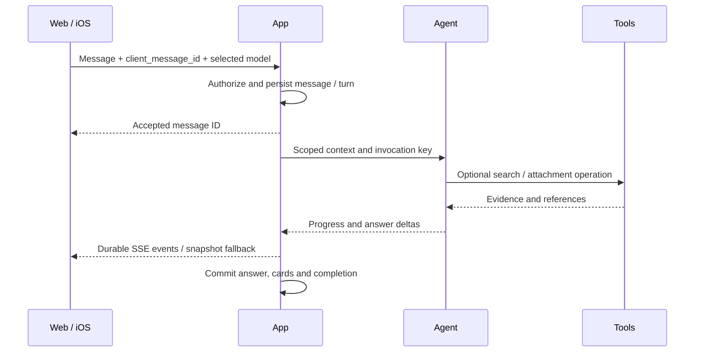

# Architecture

[中文](../zh-CN/architecture.md) · [README](../../README.md)

## Boundaries and ownership

| Domain | Runtime | Owns |
| --- | --- | --- |
| App | Java 21 / Spring Boot | Users, sessions, conversations, messages, memories, files, artifacts, public API |
| Automation | Java 21 / Spring Boot | Schedules, occurrences, runs, leases, delivery state |
| Agent | Python / FastAPI | Context assembly, routing, model invocations, immutable checkpoints |
| Tools | Python / FastAPI | Provider adapters, tool effect ledger, media jobs and reconciliation |

Runners are isolated execution infrastructure, not additional business domains. Each service accesses its own PostgreSQL schema through a service role. Internal HTTP calls validate issuer, audience, scope, owner and resource. The client only talks to App.

## Interactive conversation

The client may render an optimistic message, but PostgreSQL determines accepted messages and ordering. Reusing a client message ID must not submit another logical turn. SSE has event sequence numbers; snapshots restore committed messages and in-progress text. Native clients attempt streaming and retain polling fallback. Processing summaries are bounded status text, not hidden model reasoning.

Explicit creative work and schedules are routed before ordinary text generation. Model prose cannot fabricate success: task IDs, schedule confirmation, and artifacts must come from actual service receipts.

## Three layers of memory

- **L1 working:** short-lived context cache in Redis, reconstructed from authoritative data.
- **L2 conversation:** persisted messages and conversation summaries.
- **L3 long-term:** user-managed facts with revisions and source provenance.

Memory is distinct from an Agent checkpoint and from Automation run state. Deletion uses tombstones and revision checks so old summaries, delayed extraction and search reindexing cannot resurrect deleted facts.

## Durable background work

1. Scheduler claims due occurrences in a short PostgreSQL transaction with `FOR UPDATE SKIP LOCKED`.
2. A unique `(schedule_id, scheduled_at)` constraint prevents duplicate logical occurrences.
3. Workers claim leases with a fencing epoch and attempt ID; slow work happens outside database locks.
4. Agent writes an immutable checkpoint first. Automation commits its reference with a compare-and-set update second.
5. Tool effects use a stable effect key and durable provider job ID. Unknown submissions are reconciled rather than blindly repeated.
6. Outbox delivery and consumer deduplication return results to the originating conversation.

These mechanisms target recovery and deduplication; they do not promise external exactly-once execution or single-host high availability.

## Files, media and execution

App owns private local files and metadata. Writes proceed through temporary file → durable metadata → atomic rename → READY, with integrity and quota checks. Private playback uses expiring session-bound tickets and byte ranges. Artifacts retain immutable versions and editable source where applicable.

Generated HTML executes in a sandboxed isolated origin with resource/network limits. Provider output and uploaded documents are untrusted data. Music catalog metadata does not confer playback rights. Real media adapters and mock fixtures remain visibly distinct.

## Dependencies and failure behavior

| Dependency | Role | Failure behavior |
| --- | --- | --- |
| PostgreSQL | Authoritative state | Reject unsafe durable writes |
| Redis | Rebuildable L1 cache | Cache miss / rebuild, preserve durable state |
| Elasticsearch | Async search index | Degrade to PostgreSQL search and retry indexing |
| Local persistent disk | Private file objects | Report storage/integrity failure; preserve metadata state |
| External provider | Models/search/media | Explicit rejection, timeout or UNKNOWN reconciliation |

See [service contracts](../SERVICE_CONTRACTS.md), [storage](../LOCAL_FILE_STORAGE.md), [recovery runbook](../RUNBOOK.md), and [original design](../Adex_Product_Technical_Design_v4.1.md). Design requirements are contracts; only acceptance evidence establishes a tested result.
